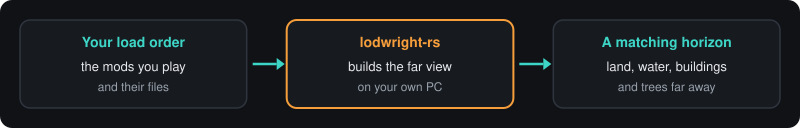
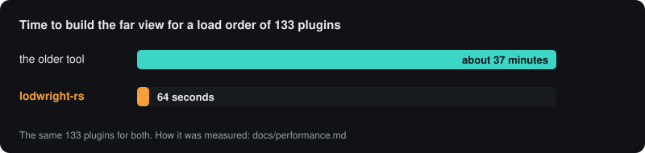
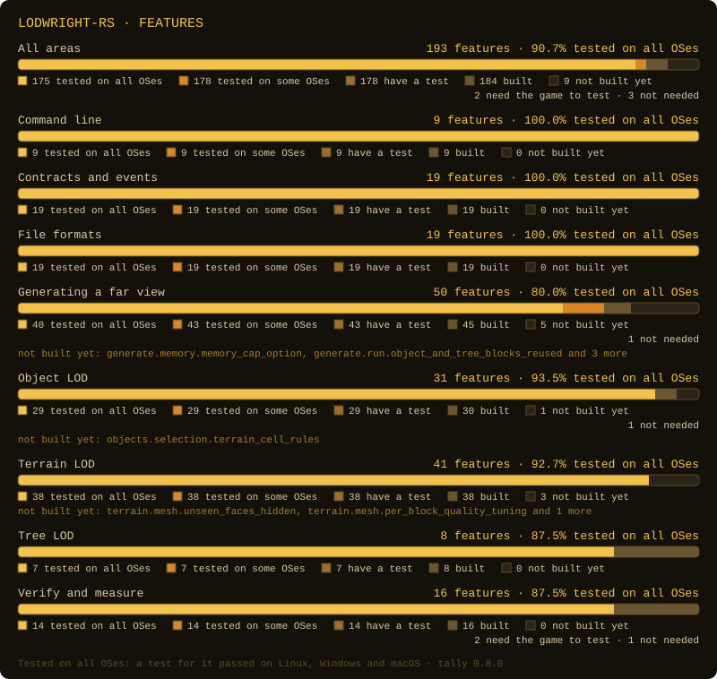
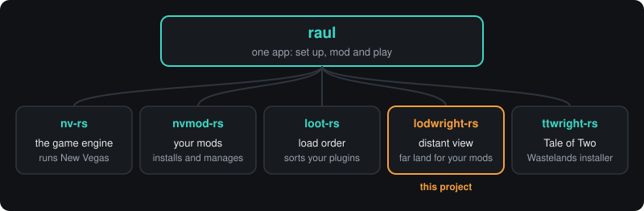

# lodwright-rs

**lodwright builds the distant view of Fallout: New Vegas for your own mods**: the land, water, buildings and trees
you see far away. Without it, mods change the world up close while the horizon still shows the old, unmodded one.

  

## Before and after

  
   <em>The Strip on a Tale of Two Wastelands setup with 312 mods: the game's far view (left) and lodwright's (right). The casinos are back.</em>

  
   <em>Large far objects stay in view: the I-15 overpasses north of Freeside no longer vanish at mid distance.</em>

  
   <em>On the unmodded game it matches the original: Hoover Dam, the game's far view (left) and lodwright's (right).</em>

## Fast

  

- 🖥️ Runs on Linux, Windows and macOS; the older tools run on Windows only.
- 🌊 Draws land, lakes and rivers, buildings and trees far away.
- 🔁 Run it again after you change your mods; far land that did not change is kept.

## What it covers

  

Every promise lodwright makes is listed in a catalogue, and the chart shows how many of them a passing test on Linux, Windows and macOS proves.

## How it fits together

  

lodwright is one part of [raul](https://github.com/JorisJonkers-dev/rauls-trusty-toolbox). As its own project it is
tested on its own: its output is compared, piece by piece, with the game's own far view.

## Get it

**[Download raul](https://github.com/JorisJonkers-dev/rauls-trusty-toolbox/releases/latest)**: lodwright is built
in; open the LOD page (the far view) and press Generate. lodwright also runs on its own from the command line
([docs/USAGE.md](docs/USAGE.md)).

## Learn more

- [Using lodwright](docs/USAGE.md): raul's LOD page, the commands, downloads and checking them.
- [More detail](docs/OVERVIEW.md): recent work, the clean-room rule, and where to read next.
- [What is still open](docs/gap-list.md) and [speed measurements](docs/performance.md).

Licence: GPL-3.0-only, with two files translated from xEdit kept under MPL-2.0 ([docs/LICENSING.md](docs/LICENSING.md)).
