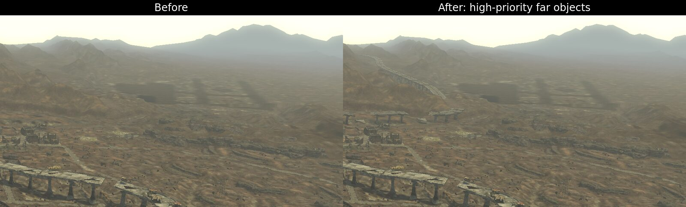

# lodwright-rs

`lodwright` builds the distant land of Fallout: New Vegas and Tale of Two Wastelands: the far terrain, its water,
the far objects and the trees you see past the loaded cells (LOD, level of detail). It reads your load order and your
data folder and writes LOD that matches that load order, so mods that change the world also change what you see in
the distance. It is written in Rust, clean-room, and builds natively for Linux, Windows and macOS; the existing
generators are Windows-only.

Most players use it through [raul](https://github.com/JorisJonkers-dev/rauls-trusty-toolbox), which has it built in.
On its own it is a command line program and a library.

**Licence: GPL-3.0-only**, with two files translated from xEdit kept under MPL-2.0 ([docs/LICENSING.md](docs/LICENSING.md)).

## What it does for your game

The game ships a far view made for the unmodded world. With mods, that far view no longer matches: new buildings are
missing at a distance, changed land shows its old shape, and Tale of Two Wastelands' worlds get no fitting far view at
all. lodwright generates it again for exactly the plugins you play with.

<p align="center">
  
  
  <br><em>A 312-mod Tale of Two Wastelands load order without (left) and with (right) the far view lodwright generated
  for it: Black Mountain's dishes and the Strip's casinos and buildings are back.</em>
</p>

On the plain game, the far view it generates is meant to look like the game's own, and it is checked against it:

<p align="center">
  
  <br><em>Hoover Dam and Lake Mead on the plain game: the game's own far view (left) and lodwright's (right).</em>
</p>

Recent work that shows in the pictures:

- **Far objects as the game's own.** All 295 object blocks of the main world have the game's vertex and triangle
  counts (99.98 percent of vertices in place). Far-object textures keep their own size on several atlases, and a
  block over the 16-bit limits is written as several shapes instead of losing objects.
- **Objects without a far model** can be drawn from a simplified full model, and include rules take chosen objects
  into the far view (0.17.0).
- **Large far objects stay in view.** Objects a load order marks as high priority on their static (as Tale of Two
  Wastelands' far-view plugin does for the I-15 overpasses) also go into the blocks the game draws farthest, so they no
  longer vanish at mid distance.

<p align="center">
  
  <br><em>North of Freeside on a modded Tale of Two Wastelands load order: before (left) and after (right).</em>
</p>

- **Far land lit as the near land is.** The game's own far-land tiles are kept where no mod changed the land, and a
  composed tile is darkened to match the land near the player.
- **Far water.** Lakes and rivers are drawn at a distance, with water walls at block borders so no gaps show.
- **Speed.** On a 133-plugin load order, xLODGen averages about 37 minutes and lodwright takes 64 seconds on 16
  threads; step-by-step figures are in [docs/performance.md](docs/performance.md).

What is still open, with measurements, is in [docs/gap-list.md](docs/gap-list.md).

## Used from raul

raul's LOD page runs lodwright for the active profile: it reads the profile's active plugins and its staged data
folder, generates terrain, objects and trees, and keeps the output as one Mod, `Generated LOD (<profile>)`, in the
mod list. A new run replaces it and keeps its place. The LOD settings page sets the options of the request raul
sends.

<p align="center">
  
  
</p>

The same from raul's command line: `raul lod plan`, `raul lod generate` and `raul lod settings`.

## On its own

```sh
lodwright plan --data <Data folder> --load-order plugins.txt              # what a run would build
lodwright generate --data <Data folder> --load-order plugins.txt --out <folder>
lodwright verify <folder> [--reference <another folder>]                  # check the output's formats
lodwright landmarks --request FILE --landmarks FILE                       # are named landmarks drawn?
lodwright --help                                                          # every command
```

`generate` reads archives and loose files, writes terrain blocks with water, terrain textures, the world settings
file, object blocks with their atlases, tree LOD and a manifest. A second run keeps the terrain blocks whose inputs did
not change. A request document (`lodwright schema request`) is how a program drives a run; the contracts are in
[docs/contracts.md](docs/contracts.md). Programs can also link the `lodwright-api` crate, as raul does.

Each [release](https://github.com/JorisJonkers-dev/lodwright-rs/releases/latest) attaches the binary for Linux
x86-64 and for macOS (one universal binary), with `SHA256SUMS` and the contract schemas, and publishes an OCI package
for Linux: `ghcr.io/jorisjonkers-dev/lodwright-rs:<version>-x86_64-unknown-linux-gnu`. Check it with
`gh attestation verify oci://ghcr.io/jorisjonkers-dev/lodwright-rs:<version>-x86_64-unknown-linux-gnu --repo JorisJonkers-dev/lodwright-rs`
(GitHub CLI 2.49 or newer and a login: run `gh auth login` or set `GH_TOKEN`, even though the package is public).

#### Pulling and verifying without a login or docker

The package is public, so an anonymous token is enough. With `curl`, `python3` and `sha256sum` (replace `<version>`):

```sh
TAG=<version>-x86_64-unknown-linux-gnu
TOKEN=$(curl -s "https://ghcr.io/token?scope=repository:jorisjonkers-dev/lodwright-rs:pull" | python3 -c 'import sys,json;print(json.load(sys.stdin)["token"])')
# the manifest (keep the digest header: it is the manifest digest) and the layer it names
curl -s -D headers.txt -H "Authorization: Bearer $TOKEN" -H "Accept: application/vnd.oci.image.manifest.v1+json" \
  -o manifest.json "https://ghcr.io/v2/jorisjonkers-dev/lodwright-rs/manifests/$TAG"
LAYER=$(python3 -c 'import json;print(json.load(open("manifest.json"))["layers"][0]["digest"])')
curl -sL -H "Authorization: Bearer $TOKEN" -o lodwright.tar.gz "https://ghcr.io/v2/jorisjonkers-dev/lodwright-rs/blobs/$LAYER"
sha256sum lodwright.tar.gz    # equals the Archive SHA-256 of the release notes and the layer digest
```

To verify the attestation without a login, fetch its bundle from the public API (the digest is the manifest digest
from `headers.txt`, `docker-content-digest`) and give it to `gh`, which then needs no token:

```sh
DIGEST=$(grep -i '^docker-content-digest:' headers.txt | tr -d '\r' | cut -d' ' -f2)
curl -s "https://api.github.com/repos/JorisJonkers-dev/lodwright-rs/attestations/$DIGEST" \
  | python3 -c 'import sys,json;[print(json.dumps(a["bundle"])) for a in json.load(sys.stdin)["attestations"]]' > bundle.jsonl
gh attestation verify oci://ghcr.io/jorisjonkers-dev/lodwright-rs:$TAG --bundle bundle.jsonl --repo JorisJonkers-dev/lodwright-rs
```

`gh` exits 0 when the bundle verifies. The unauthenticated GitHub API allows 60 requests an hour per address.

## Why a separate project

lodwright is one of the Components raul is made of, next to [nv-rs](https://github.com/JorisJonkers-dev/nv-rs),
[nvmod-rs](https://github.com/JorisJonkers-dev/nvmod-rs), [loot-rs](https://github.com/JorisJonkers-dev/loot-rs) and
[ttwright-rs](https://github.com/JorisJonkers-dev/ttwright-rs). Each does one job, is tested on its own and releases
on its own schedule; raul links them into one program and ships one tested set. lodwright in particular is checked
without raul: its output is compared block by block with the game's own far view.

## Clean-room rule

Format facts come from public format documents, the MPL-2.0 xEdit source, public readmes, Microsoft's DDS
documentation, the game's own data formats on a contributor's machine, and black-box output of an existing generator
run on the contributor's own data. Decompiled or leaked code and unlicensed source are never read. Every fact the
code relies on is recorded in `provenance/` (CI checks the record). Game data and reference output never go in this
repository; test fixtures are synthetic. The rule is in [docs/clean-room.md](docs/clean-room.md).

## Where to read next

- [docs/gap-list.md](docs/gap-list.md): what full generation needs and what exists.
- [docs/design.md](docs/design.md): pipeline, crates, interfaces, open questions.
- [docs/RELEASE-TEST.md](docs/RELEASE-TEST.md): the checklist a release passes on real data.
- [docs/TESTING.md](docs/TESTING.md): synthetic fixtures, properties and the `verify` design.
- [docs/LICENSING.md](docs/LICENSING.md): which crate carries which licence.
- [docs/PRACTICES.md](docs/PRACTICES.md), [CONTRIBUTING.md](CONTRIBUTING.md), [SECURITY.md](SECURITY.md).
